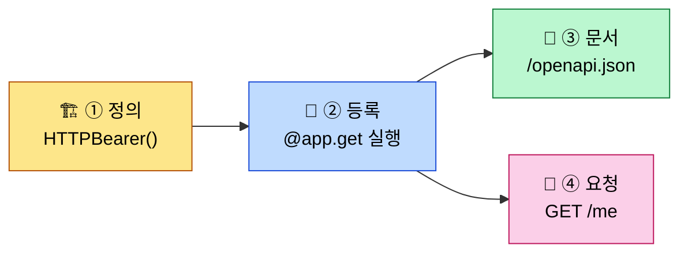
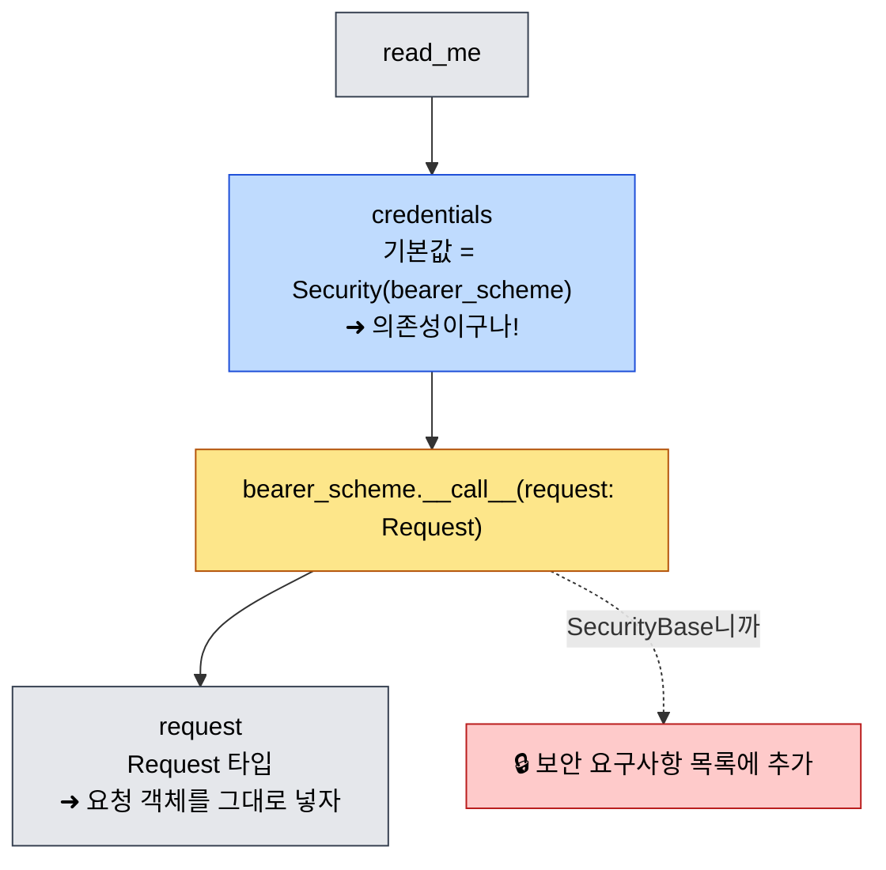
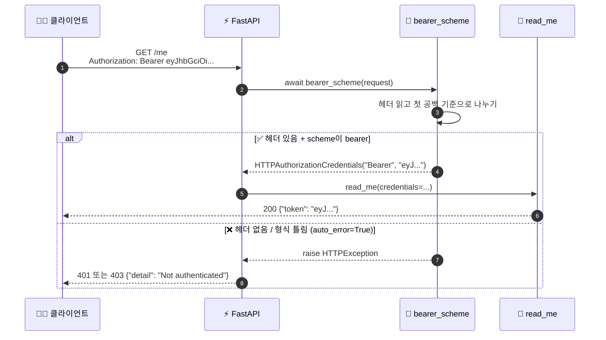
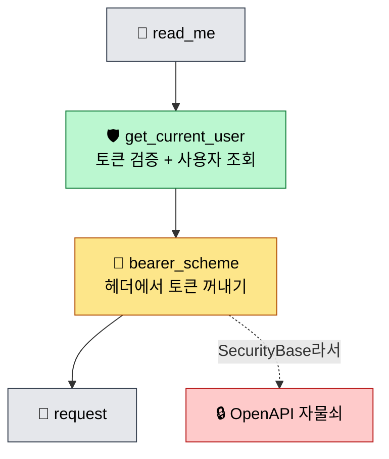
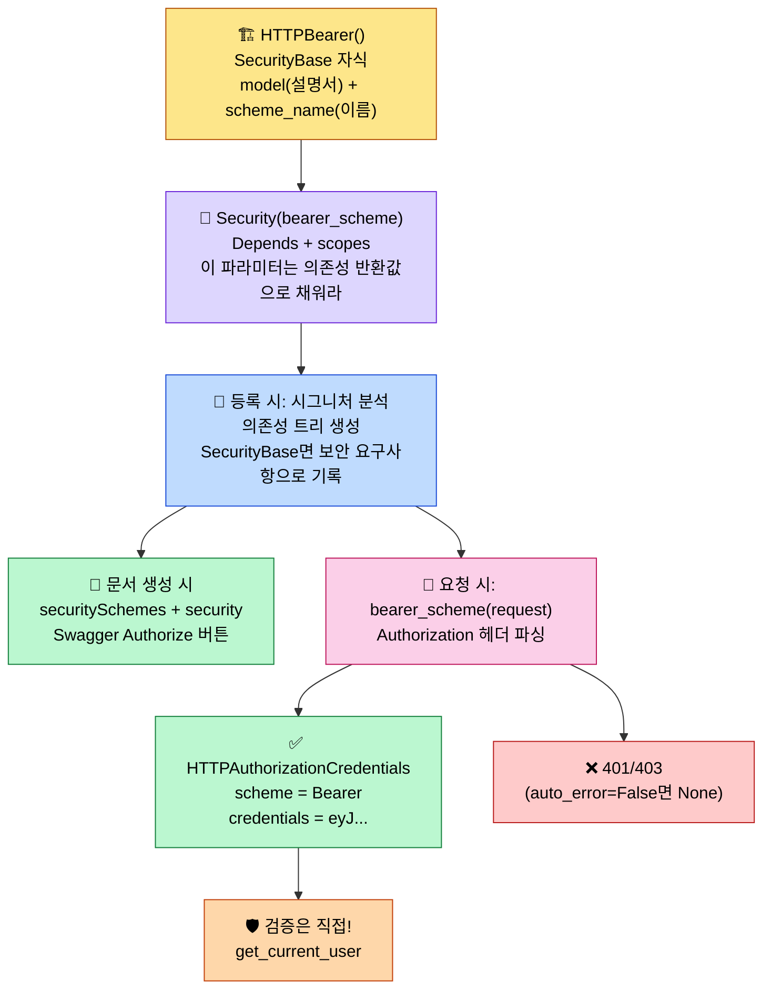

# 🔐 FastAPI `Security(bearer_scheme)` 동작 과정

```python
from fastapi import FastAPI, Security
from fastapi.security import HTTPBearer, HTTPAuthorizationCredentials

app = FastAPI()
bearer_scheme = HTTPBearer()

@app.get("/me")
def read_me(credentials: HTTPAuthorizationCredentials = Security(bearer_scheme)):
    return {"token": credentials.credentials}
```

> [!NOTE]
> 이 짧은 코드는 **네 시점**에 각각 다른 일을 합니다. 아래 그림의 순서대로 읽으면 됩니다.



| 시점 | 언제 | 하는 일 |
|---|---|---|
| 🏗️ **① 정의** | 모듈을 불러올 때 | `HTTPBearer()` 객체가 "나는 Bearer 인증 방식이다"라는 정보를 들고 만들어진다 |
| 📝 **② 등록** | `@app.get(...)`이 실행될 때 | 함수 시그니처를 읽고 "이 엔드포인트는 Bearer 인증이 필요하다"고 기록한다 |
| 📖 **③ 문서** | `/openapi.json`을 처음 요청할 때 | 기록을 보고 `securitySchemes`와 `security`를 만든다. Swagger UI에 Authorize 버튼이 생긴다 |
| 📨 **④ 요청** | 실제 HTTP 요청이 올 때 | `bearer_scheme(request)`를 호출해 헤더에서 토큰을 꺼내 `credentials`에 넣는다 |

---

## 🏗️ ① 정의: `bearer_scheme = HTTPBearer()`

`HTTPBearer`는 평범한 클래스이고, 객체를 **함수처럼 호출할 수 있게** `__call__`을 가지고 있습니다. FastAPI 입장에서는 "호출 가능한 의존성"일 뿐입니다.

생성자에서는 세 가지를 저장합니다.

```python
class HTTPBearer(HTTPBase):          # HTTPBase → SecurityBase 상속
    def __init__(self, *, bearerFormat=None, scheme_name=None,
                 description=None, auto_error=True):
        self.model = HTTPBearerModel(bearerFormat=bearerFormat, description=description)
        #            └ OpenAPI에 그대로 들어갈 정보: {"type": "http", "scheme": "bearer"}
        self.scheme_name = scheme_name or self.__class__.__name__   # 기본값 "HTTPBearer"
        self.auto_error = auto_error
```

| 필드 | 역할 | 언제 쓰이나 |
|---|---|---|
| 📄 `self.model` | OpenAPI 문서에 쓸 **설명서** | ③ 문서 |
| 🏷️ `self.scheme_name` | 문서에서 이 방식을 부르는 **이름** (기본값 `"HTTPBearer"`) | ③ 문서 |
| 🚦 `self.auto_error` | 토큰이 없을 때 **에러를 낼지, `None`을 돌려줄지** | ④ 요청 |

> [!IMPORTANT]
> 이 객체가 **`SecurityBase`의 자식**이라는 점이 핵심입니다. FastAPI는 이 사실 하나로 "보안 관련 의존성"인지를 판별합니다.

---

## 📝 ② 등록: `@app.get("/me")`가 실행될 때

데코레이터가 실행되면 FastAPI는 `read_me`의 시그니처를 분석해 **의존성 트리(Dependant)** 를 만듭니다. 요청이 올 때마다 분석하지 않고, 이때 **한 번만** 합니다.



1. 🔍 `credentials` 파라미터의 기본값이 `Security(...)` 객체입니다. 그래서 쿼리 파라미터가 아니라 **의존성**으로 분류됩니다.
2. 🔁 FastAPI는 `bearer_scheme`의 `__call__` 시그니처를 다시 분석합니다. 파라미터가 `request: Request` 하나라서 "요청 객체를 넘기면 된다"고 기록합니다. 의존성 안의 의존성도 같은 방식으로 끝까지 따라갑니다.
3. 🔒 `bearer_scheme`가 `SecurityBase`의 인스턴스이므로, 이 엔드포인트의 **보안 요구사항 목록**에 추가합니다.

### ❓ 타입 힌트 `HTTPAuthorizationCredentials`는 무슨 역할인가요?

> [!WARNING]
> **FastAPI는 이 타입 힌트를 검증에 쓰지 않습니다.** 의존성의 반환값이 그대로 들어갈 뿐입니다.
> 힌트는 에디터 자동완성과 가독성을 위한 것이라, 힌트가 틀려도 실행 중에는 아무도 알려 주지 않습니다.

### ❓ `Security()`와 `Depends()`는 뭐가 다른가요?

`Security`는 `Depends`를 상속한 클래스이고, 추가된 것은 **`scopes` 인자 하나**뿐입니다.

```python
Security(bearer_scheme)                        # Depends(bearer_scheme)와 사실상 같다
Security(oauth2_scheme, scopes=["items:read"]) # scopes는 OAuth2에서만 의미가 있다
```

> [!TIP]
> OpenAPI에 보안 정보가 들어가는 이유는 `Security()`를 써서가 아니라, **의존성 객체가 `SecurityBase`이기 때문**입니다.
> 그래서 `Depends(bearer_scheme)`로 써도 문서에 똑같이 자물쇠가 붙습니다.
> 그래도 `Security`로 쓰면 "이건 인증용 의존성이다"라는 의도가 코드에 드러나고, 나중에 OAuth2 scope를 붙이기도 쉽습니다.

---

## 📖 ③ 문서: OpenAPI에 `security`가 생기는 과정

`/openapi.json`을 만들 때 FastAPI는 모든 엔드포인트의 의존성 트리를 펼쳐서 보안 요구사항을 모읍니다.

**🌐 문서 전체에 한 번** (`components.securitySchemes`): `scheme_name`을 키로, `model`을 값으로 씁니다.

```json
"components": {
  "securitySchemes": {
    "HTTPBearer": { "type": "http", "scheme": "bearer" }
  }
}
```

**🔒 보안 의존성을 쓰는 엔드포인트마다** (`security`)

```json
"/me": {
  "get": {
    "security": [ { "HTTPBearer": [] } ]
  }
}
```

- `[]` 자리는 OAuth2 scope 목록입니다. Bearer에서는 늘 비어 있습니다.
- 🔓 Swagger UI는 이 두 정보를 보고 오른쪽 위에 **Authorize 버튼**을 만들고, `security`가 있는 엔드포인트에만 **자물쇠 아이콘**을 붙입니다.
- 🔑 Authorize에 토큰을 넣으면 그 엔드포인트를 호출할 때 `Authorization: Bearer <토큰>` 헤더를 자동으로 붙여 줍니다.

> [!NOTE]
> 의존성 안의 의존성까지 펼쳐서 모으기 때문에, `get_current_user`가 안에서 `Security(bearer_scheme)`를 쓰면 `get_current_user`만 쓴 엔드포인트에도 자물쇠가 붙습니다.

---

## 📨 ④ 요청: `credentials`에 값이 들어오기까지

요청이 들어오면 FastAPI는 ②에서 만든 트리를 따라 의존성을 **안쪽부터** 풀어 냅니다(`solve_dependencies`).



실제 코드를 단순화하면 이 정도입니다.

```python
async def __call__(self, request: Request) -> HTTPAuthorizationCredentials | None:
    authorization = request.headers.get("Authorization")
    scheme, credentials = get_authorization_scheme_param(authorization)   # "Bearer abc" → ("Bearer", "abc")

    if not (authorization and scheme and credentials):      # ❌ 헤더가 없거나 비었다
        if self.auto_error:
            raise HTTPException(status_code=..., detail="Not authenticated")
        return None

    if scheme.lower() != "bearer":                          # ❌ Basic 같은 다른 방식이다
        if self.auto_error:
            raise HTTPException(status_code=..., detail="Invalid authentication credentials")
        return None

    return HTTPAuthorizationCredentials(scheme=scheme, credentials=credentials)   # ✅
```

어떤 헤더가 어떤 결과가 되는지 보면 이렇습니다.

```diff
+ Authorization: Bearer eyJhbGciOi...   → ✅ credentials="eyJhbGciOi..."
+ Authorization: bearer eyJhbGciOi...   → ✅ 대소문자 무시
- (헤더 없음)                            → ❌ Not authenticated
- Authorization: Bearer                 → ❌ Not authenticated (토큰 부분이 비었다)
- Authorization: Basic dXNlcjpwYXNz     → ❌ Invalid authentication credentials
```

### 🚨 에러가 나면

- `HTTPException`을 던지면 `read_me`는 **호출되지 않습니다.** FastAPI의 예외 핸들러가 `{"detail": "Not authenticated"}` 같은 JSON 응답을 바로 돌려줍니다.

> [!CAUTION]
> 상태 코드는 **FastAPI 버전에 따라 다릅니다.** 예전 버전은 `403 Forbidden`을 돌려줬고, 최근 버전은 HTTP 표준에 맞게 `401 Unauthorized`와 `WWW-Authenticate: Bearer` 헤더를 돌려주도록 바뀌었습니다. 쓰시는 버전의 소스를 확인하는 게 정확합니다.

### 🟡 `auto_error=False`이면

에러 대신 `None`이 들어옵니다. "로그인했으면 사용자 정보, 아니면 익명"처럼 **선택 인증**에 씁니다.

```python
optional_bearer = HTTPBearer(auto_error=False)

@app.get("/feed")
def feed(credentials: HTTPAuthorizationCredentials | None = Security(optional_bearer)):
    if credentials is None:
        return public_feed()
    ...
```

### ♻️ 같은 요청 안에서는 한 번만 호출됩니다

한 요청에서 여러 의존성이 `bearer_scheme`를 쓰더라도, FastAPI는 `(의존성, scopes)`를 키로 결과를 캐시해서 **한 번만 호출**합니다. 매번 다시 부르게 하려면 `Security(bearer_scheme, use_cache=False)`라고 씁니다. 이 캐시는 요청 하나 안에서만 유지됩니다.

---

## ⚠️ 가장 많이 하는 오해: `HTTPBearer`는 토큰을 검증하지 않는다

> [!CAUTION]
> `HTTPBearer`가 하는 일은 **헤더에서 토큰 문자열을 꺼내는 것까지**입니다. 서명 확인, 만료 확인, 사용자 조회는 하지 않습니다.
> `Authorization: Bearer 아무거나`를 보내도 통과합니다.

그래서 실제로는 검증용 의존성을 한 겹 더 씌웁니다.

```python
def get_current_user(
    credentials: HTTPAuthorizationCredentials = Security(bearer_scheme),
) -> User:
    payload = verify_jwt(credentials.credentials)     # 서명·만료 검증. 실패하면 401을 던진다
    return user_repository.find(payload["sub"])

@app.get("/me")
def read_me(user: User = Depends(get_current_user)):
    return user
```



| 의존성 | 맡는 질문 |
|---|---|
| 🔐 `bearer_scheme` | 토큰이 **어디에, 어떤 형식으로** 오는가? |
| 🛡️ `get_current_user` | 그 토큰이 **유효한가**, 누구의 것인가? |

> [!TIP]
> `read_me`는 `Depends(get_current_user)`만 썼지만, 트리 안에 `bearer_scheme`가 있으므로 OpenAPI에 자물쇠가 붙습니다.

---

## 📌 한 장 요약



---

## ☕ minihttp에 옮긴다면

앞에서 설계한 `BearerSchema<T>`와 맞춰 보면 이렇습니다.

| | 🐍 FastAPI | ☕ minihttp |
|---|---|---|
| 인증 방식 클래스 | `HTTPBearer` (`SecurityBase` 자식) | `BearerSchema<T>` (`Dependency<T>` 구현) |
| 파라미터 선언 | `Security(bearer_scheme)` / `Depends(...)` | `@Depends(SomeBearer.class)` |
| 보안 의존성 판별 | `isinstance(call, SecurityBase)` | `BearerSchema.class.isAssignableFrom(dependencyType)` |
| 등록 시 분석 결과 | `Dependant` 트리 | `ParameterSpec`의 `source == DEPENDENCY`, `dependencyType` |
| OpenAPI 출력 | `get_openapi`의 `securitySchemes` / `security` | `OpenApiDocument.toTree()` / `operation()` |
| 헤더 파싱 | `__call__` | `final`로 막은 `BearerSchema.resolve()` |
| 토큰 검증 | `get_current_user` 의존성 | `authenticate(String token)` 구현 |
| 선택 인증 | `auto_error=False` | 별도의 `OptionalBearerSchema` |
| 요청 단위 캐시 | ✅ 있음 | ❌ 없음 (같은 Dependency를 여러 파라미터에서 쓰면 여러 번 호출됨) |

> [!IMPORTANT]
> FastAPI는 "의존성 안의 의존성"까지 펼쳐서 보안 요구사항을 모으지만, minihttp의 `Dependency`는 다른 `Dependency`를 `@Depends`로 받을 수 없습니다.
> 그래서 minihttp에서는 **검증까지 `BearerSchema` 상속 클래스 안에서 끝내는 구조**(`authenticate`)가 더 자연스럽습니다.
