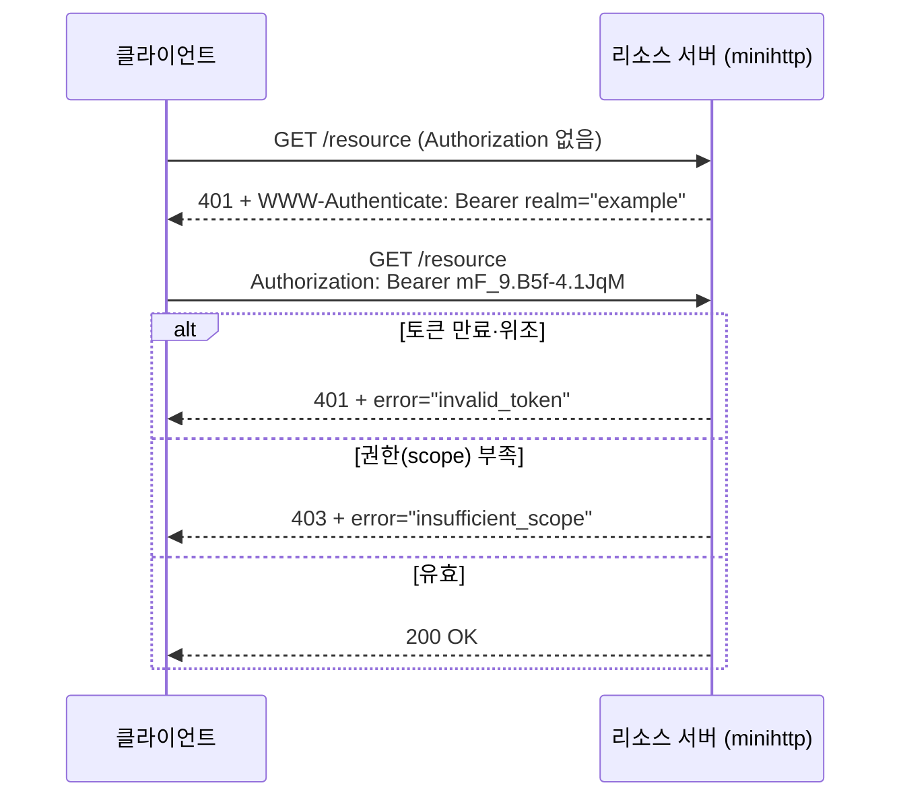

# 🔑 RFC 6750 — OAuth 2.0 Bearer 토큰 사용법 (한국어 정리, 발췌)

> [!NOTE]
> 이 문서는 [RFC 6750](https://www.rfc-editor.org/rfc/rfc6750)의 비공식 한국어 정리·번역입니다. 원문과 차이가 있으면 원문이 우선합니다.
> minihttp의 `BearerSchema<T>` 구현에 필요한 부분(§1.1–1.2, §2, §3, §4, §5)만 옮겼고, 작성 동기·IANA 등록 상세·참고문헌은 뺐습니다.
> 요구 수준 키워드(MUST, SHOULD, MAY 등)는 번역 뒤에 괄호로 원어를 함께 적었습니다. ABNF 문법과 예시는 원문 그대로 두었습니다.
> 인증 프레임워크 전반은 [RFC 7235 정리](rfc7235-ko.md), Basic 스킴은 [RFC 7617 정리](rfc7617-ko.md), HTTP 의미론은 [RFC 9110 번역](rfc9110-ko.md)을 참고하세요.

- 원문 저자: M. Jones(Microsoft), D. Hardt(Independent)
- 발행: 2012년 10월 · IETF Standards Track

## 📑 목차

- [📌 한눈에 보기](#-한눈에-보기)
- [📖 1. 표기 규칙과 용어 (§1.1–1.2)](#-1-표기-규칙과-용어-11-12)
- [📤 2. 인증된 요청 보내기 (§2)](#-2-인증된-요청-보내기-2)
- [📥 3. WWW-Authenticate 응답 헤더 (§3)](#-3-www-authenticate-응답-헤더-3)
- [🚨 3.1. 에러 코드 (§3.1)](#-31-에러-코드-31)
- [🎟️ 4. 액세스 토큰 응답 예시 (§4)](#️-4-액세스-토큰-응답-예시-4)
- [🛡️ 5. 보안 고려사항 (§5)](#️-5-보안-고려사항-5)
- [🛠️ minihttp 구현 체크리스트](#️-minihttp-구현-체크리스트)

---

## 📌 한눈에 보기

| 항목 | 내용 |
|---|---|
| 요청 형식 | `Authorization: Bearer <b64token>` |
| 서버가 반드시 지원할 방식 | `Authorization` 헤더 (§2.1) |
| 선택적·비권장 방식 | form body `access_token=` (§2.2), URI 쿼리 `?access_token=` (§2.3) |
| 실패 응답 헤더 | `WWW-Authenticate: Bearer realm="...", error="...", ...` |
| 에러 코드 | `invalid_request`(400) · `invalid_token`(401) · `insufficient_scope`(403) |
| 전송 계층 | TLS(https) 필수 |



---

## 📖 1. 표기 규칙과 용어 (§1.1–1.2)

### 표기 규칙 (§1.1)

- ABNF는 [RFC 5234] 표기를 따르고, `auth-param`·`auth-scheme`은 HTTP 인증 규격(RFC 2617, 현재는 RFC 7235 → RFC 9110 §11)에서, `URI-reference`는 RFC 3986에서 가져옵니다.
- 따로 언급하지 않는 한, **모든 프로토콜 파라미터 이름과 값은 대소문자를 구분합니다(case sensitive).**

> [!IMPORTANT]
> 위 "대소문자 구분" 규칙은 `realm`, `scope`, `error` 같은 **파라미터 이름·값**에 대한 것입니다. 스킴 이름 `Bearer` 자체는 HTTP 인증 프레임워크([RFC 7235 §2.1](rfc7235-ko.md), RFC 9110 §11.1)에 따라 **대소문자를 구분하지 않는** 토큰이므로 `bearer`, `BEARER`도 받아들여야 합니다.

### Bearer 토큰이란 (§1.2)

> **Bearer Token** — 토큰을 **가진 사람("bearer")이면 누구든**, 그 토큰을 가진 다른 누구와도 똑같은 방식으로 사용할 수 있는 보안 토큰입니다. 사용할 때 암호 키를 가지고 있음을 증명(proof-of-possession)할 필요가 없습니다.

> [!WARNING]
> 즉, 토큰이 **유출되면 곧바로 도용**됩니다. 이 RFC의 보안 요구 사항(§5)이 대부분 "토큰을 새지 않게 하라"로 모이는 이유입니다.

이 규격은 OAuth 2.0 흐름에서 나온 토큰을 염두에 두고 만들었지만, 실제로는 **출처와 상관없이 bearer 토큰으로 리소스를 보호하는 일반 HTTP 인증 방식**을 정의합니다. 주로 `WWW-Authenticate`/`Authorization` 헤더를 쓰는 서버 인증용이지만, 프록시 인증(`Proxy-Authenticate`/`Proxy-Authorization`)에 쓰는 것을 막지는 않습니다.

---

## 📤 2. 인증된 요청 보내기 (§2)

리소스 요청에 bearer 토큰을 실어 보내는 방법은 세 가지입니다. 클라이언트는 한 요청에서 **둘 이상의 방법을 함께 쓰면 안 됩니다(MUST NOT).**

| 방법 | 절 | 클라이언트 | 리소스 서버 |
|---|---|---|---|
| `Authorization` 요청 헤더 | §2.1 | 사용해야 함(SHOULD) | **반드시 지원(MUST)** |
| form-encoded body 파라미터 | §2.2 | 원칙적으로 쓰지 않음(SHOULD NOT) | 지원해도 됨(MAY) |
| URI 쿼리 파라미터 | §2.3 | 원칙적으로 쓰지 않음(SHOULD NOT) | 지원해도 됨(MAY) |

### 2.1. Authorization 요청 헤더 (§2.1) ⭐

`Authorization` 요청 헤더로 토큰을 보낼 때 클라이언트는 `Bearer` 인증 스킴을 사용합니다.

```http
GET /resource HTTP/1.1
Host: server.example.com
Authorization: Bearer mF_9.B5f-4.1JqM
```

이 스킴의 `Authorization` 헤더 문법은 Basic 스킴(RFC 2617 §2)의 쓰임새를 따릅니다. Basic과 마찬가지로 RFC 2617 §1.2의 일반 문법(`auth-param` 목록)을 따르지는 않지만, 기존 배포 현실을 반영하기 위해 이렇게 정했으며 HTTP/1.1 인증 프레임워크와는 호환됩니다. Bearer 자격 증명(credentials)의 문법은 다음과 같습니다.

```abnf
b64token    = 1*( ALPHA / DIGIT /
                  "-" / "." / "_" / "~" / "+" / "/" ) *"="
credentials = "Bearer" 1*SP b64token
```

| 구성 요소 | 의미 |
|---|---|
| `1*( ALPHA / DIGIT / - . _ ~ + / )` | 영문자, 숫자, `-` `.` `_` `~` `+` `/` 중 **1개 이상** |
| `*"="` | 끝에 `=` 패딩이 **0개 이상** (중간에는 올 수 없음) |
| `1*SP` | 스킴과 토큰 사이 **공백 1개 이상** |

> [!TIP]
> `b64token`은 RFC 7235의 `token68`과 같은 문자 집합입니다. 이름에 "b64"가 들어 있지만 **토큰을 Base64로 디코딩하라는 뜻이 아닙니다.** 서버는 토큰을 불투명(opaque) 문자열로 받아 검증 로직에 넘기면 됩니다. JWT(`xxx.yyy.zzz`)도 이 문법에 맞습니다.

클라이언트는 bearer 토큰으로 인증된 요청을 보낼 때 `Authorization` 요청 헤더와 `Bearer` 스킴을 사용해야 합니다(SHOULD). 리소스 서버는 **이 방식을 반드시 지원해야 합니다(MUST).**

### 2.2. Form-Encoded Body 파라미터 (§2.2) — 비권장

요청 본문에 `access_token=mF_9.B5f-4.1JqM` 형태로 넣는 방식입니다. 다음 조건을 **모두** 만족할 때만 쓸 수 있습니다(그 외엔 MUST NOT): `Content-Type: application/x-www-form-urlencoded`, 단일 파트 본문, 전부 ASCII, 본문 의미가 정의된 메서드(**GET 금지**).

> [!NOTE]
> 브라우저가 `Authorization` 헤더에 접근할 수 없는 환경이 아니면 쓰지 말아야 합니다(SHOULD NOT). 리소스 서버는 지원해도 됩니다(MAY).

### 2.3. URI 쿼리 파라미터 (§2.3) — 비권장

`GET /resource?access_token=mF_9.B5f-4.1JqM` 형태입니다. 이 방식을 쓰면 클라이언트는 `Cache-Control: no-store`를 보내야 하고(SHOULD), 서버의 2XX 응답에는 `Cache-Control: private`이 있어야 합니다(SHOULD).

> [!CAUTION]
> 토큰이 담긴 URL이 **로그에 남을 가능성이 매우 높아서** 헤더나 본문으로 보낼 수 없을 때가 아니면 쓰지 말아야 합니다(SHOULD NOT). 현재 쓰임을 기록하려고 넣었을 뿐 권장하지 않으며, 예약된 쿼리 파라미터 이름(`access_token`)을 쓰는 것 자체도 URI 네임스페이스 모범 사례에 어긋납니다.

---

## 📥 3. WWW-Authenticate 응답 헤더 (§3)

보호된 리소스 요청에 **인증 정보가 없거나**, 접근을 허용하는 **액세스 토큰이 없으면**, 리소스 서버는 **반드시 `WWW-Authenticate` 응답 헤더를 포함해야 합니다(MUST).** 다른 상황의 응답에 넣어도 됩니다(MAY).

- 이 규격의 모든 챌린지는 auth-scheme 값으로 **반드시 `Bearer`를 써야 합니다(MUST).**
- 스킴 뒤에는 **하나 이상의** `auth-param`이 와야 합니다(MUST).
- 아래 정의된 것 외의 auth-param을 써도 됩니다(MAY).

### 파라미터 정리

| 파라미터 | 필수 여부 | 중복 | 의미 |
|---|---|---|---|
| `realm` | 선택(MAY) | **불가(MUST NOT)** | 보호 범위. HTTP 인증 프레임워크의 realm과 같은 의미 |
| `scope` | 선택(OPTIONAL) | **불가(MUST NOT)** | 리소스 접근에 필요한 scope 목록. **공백 구분, 대소문자 구분, 순서 무의미** |
| `error` | 토큰이 있었는데 실패했으면 넣어야 함(SHOULD) | **불가(MUST NOT)** | 거절 이유. 값은 §3.1의 에러 코드 |
| `error_description` | 선택(MAY) | **불가(MUST NOT)** | **개발자용** 사람이 읽는 설명. 최종 사용자에게 보여 주려는 것이 아님 |
| `error_uri` | 선택(MAY) | **불가(MUST NOT)** | 에러를 설명하는 웹 페이지의 **절대 URI** |

`scope`에 대한 보충:

- 값은 구현이 정합니다. 중앙 레지스트리가 없고, 허용 값은 인가 서버가 정의합니다.
- 경우에 따라 충분한 권한의 새 토큰을 요청할 때 이 값을 그대로 씁니다.
- **프로그램용**이며 최종 사용자에게 보여 주려는 값이 아닙니다.

```http
scope="openid profile email"
scope="urn:example:channel=HBO&urn:example:rating=G,PG-13"
```

### 허용 문자 집합

파라미터 값은 따옴표 문자열 안에 들어가므로 `"`(%x22)와 `\`(%x5C)를 쓸 수 없습니다.

| 파라미터 | 허용 문자 (그 밖의 문자는 MUST NOT) |
|---|---|
| `scope` | 값: `%x21 / %x23-5B / %x5D-7E`, 구분자: `%x20`(공백) |
| `error`, `error_description` | `%x20-21 / %x23-5B / %x5D-7E` (공백 허용) |
| `error_uri` | URI-reference 문법을 따라야 하므로 `%x21 / %x23-5B / %x5D-7E` |

> [!TIP]
> 정리하면 "출력 가능한 ASCII 중 `"`와 `\` 제외"입니다. `error_description`에 **한글이나 줄바꿈을 넣으면 규격 위반**이니, 사람이 읽을 메시지가 필요하면 응답 본문(JSON 등)에 따로 넣으세요.

### 예시

인증 정보 없이 보호된 리소스를 요청했을 때:

```http
HTTP/1.1 401 Unauthorized
WWW-Authenticate: Bearer realm="example"
```

만료된 액세스 토큰으로 인증을 시도했을 때:

```http
HTTP/1.1 401 Unauthorized
WWW-Authenticate: Bearer realm="example",
                  error="invalid_token",
                  error_description="The access token expired"
```

> [!NOTE]
> 원문 예시는 가독성을 위해 줄을 나눴습니다. 실제로는 한 줄로 `WWW-Authenticate: Bearer realm="example", error="invalid_token", error_description="The access token expired"`처럼 보내면 됩니다(HTTP/1.1의 obs-fold 줄 접기는 폐기됨, [RFC 9112](rfc9112-ko.md) 참고).

---

## 🚨 3.1. 에러 코드 (§3.1)

요청이 실패하면 리소스 서버는 적절한 HTTP 상태 코드(보통 400, 401, 403, 405)로 응답하고, 응답에 아래 에러 코드 중 하나를 넣습니다.

| 에러 코드 | 상태 코드 | 언제 |
|---|---|---|
| `invalid_request` | **400** Bad Request (SHOULD) | 필수 파라미터 누락, 지원하지 않는 파라미터·값, 같은 파라미터 반복, **토큰 전달 방법을 둘 이상 사용**, 그 밖의 형식 오류 |
| `invalid_token` | **401** Unauthorized (SHOULD) | 토큰이 만료·폐기(revoked)·형식 오류이거나 그 밖의 이유로 유효하지 않음. 클라이언트는 새 토큰을 받아 재시도해도 됩니다(MAY) |
| `insufficient_scope` | **403** Forbidden (SHOULD) | 토큰이 준 권한보다 높은 권한이 필요함. 접근에 필요한 `scope`를 함께 넣어도 됩니다(MAY) |

> [!IMPORTANT]
> **인증 정보가 아예 없으면 `error`를 넣지 마세요.** 요청에 인증 정보가 전혀 없으면(예: 클라이언트가 인증이 필요한지 몰랐거나, 지원하지 않는 인증 방식을 썼으면) 리소스 서버는 **에러 코드나 그 밖의 에러 정보를 넣지 말아야 합니다(SHOULD NOT).**
>
> ```http
> HTTP/1.1 401 Unauthorized
> WWW-Authenticate: Bearer realm="example"
> ```

상황별로 정리하면 다음과 같습니다.

| 상황 | 상태 | WWW-Authenticate |
|---|---|---|
| `Authorization` 헤더 없음 | 401 | `Bearer realm="..."` (error 없음) |
| 다른 스킴 사용 (예: `Basic ...`) | 401 | `Bearer realm="..."` (error 없음 — "지원하지 않는 방식"에 해당) |
| `Bearer` 뒤 토큰 형식이 b64token에 안 맞음 | 400 또는 401 | `error="invalid_request"` 또는 `error="invalid_token"` (아래 참고) |
| 토큰 만료·위조·폐기 | 401 | `error="invalid_token"` |
| 토큰은 유효하나 권한 부족 | 403 | `error="insufficient_scope"`, 필요하면 `scope="..."` |
| 헤더·쿼리 등 두 군데에 토큰 | 400 | `error="invalid_request"` |

> [!NOTE]
> "형식이 잘못된 토큰(malformed)"은 원문에서 `invalid_token`의 예로 직접 나오고, "그 밖의 형식 오류 요청(otherwise malformed)"은 `invalid_request`에 나옵니다. `Bearer` 뒤 값이 비었거나 문법에 안 맞는 경우를 어느 쪽으로 볼지는 원문이 딱 잘라 정하지 않으므로 구현에서 한쪽으로 정해 일관되게 쓰면 됩니다. (위 표의 마지막 줄 외 다른 행은 원문 규칙을 그대로 적용한 것이고, 이 행만 해석이 들어갔습니다.)

---

## 🎟️ 4. 액세스 토큰 응답 예시 (§4)

bearer 토큰은 보통 OAuth 2.0 액세스 토큰 응답의 일부로 클라이언트에 전달됩니다. 로그인 엔드포인트를 만든다면 참고할 만한 형태입니다.

```http
HTTP/1.1 200 OK
Content-Type: application/json;charset=UTF-8
Cache-Control: no-store
Pragma: no-cache

{
  "access_token":"mF_9.B5f-4.1JqM",
  "token_type":"Bearer",
  "expires_in":3600,
  "refresh_token":"tGzv3JOkF0XG5Qx2TlKWIA"
}
```

> [!TIP]
> 토큰이 담긴 응답에는 `Cache-Control: no-store`를 붙여 중간 캐시에 남지 않게 합니다.

---

## 🛡️ 5. 보안 고려사항 (§5)

### 5.1. 위협 (§5.1)

| 위협 | 설명 |
|---|---|
| 🧪 토큰 위조·변조 | 가짜 토큰을 만들거나 기존 토큰 내용(유효 기간, 권한 등)을 고쳐 부당한 접근을 얻음 |
| 👀 토큰 노출 | 토큰 안의 인증·속성 정보에 민감한 정보가 있을 수 있음 |
| ↪️ 토큰 리다이렉트 | A 리소스 서버용 토큰을, 그것이 자기 것이라고 착각하는 B 서버에 사용 |
| 🔁 토큰 재사용(replay) | 이미 사용된 토큰을 다시 사용 |

### 5.2. 대응 (§5.2)

- **무결성:** 디지털 서명이나 MAC으로 토큰 내용을 보호하면 많은 위협을 막을 수 있습니다. 토큰 무결성 보호는 **변조를 막기에 충분해야 합니다(MUST).**
- **참조형 토큰:** 토큰에 정보를 직접 담는 대신 인가 정보를 가리키는 참조(예: 랜덤 ID)를 담을 수도 있습니다. 이 참조는 **공격자가 추측할 수 없어야 합니다(MUST).**
- **audience 제한:** 리다이렉트 대응으로, 인가 서버는 토큰에 의도한 수신자(audience, 보통 리소스 서버 하나 또는 목록)를 넣는 것이 중요합니다. 특정 scope로 사용을 제한하는 것도 권장합니다(RECOMMENDED).
- **TLS:** 인가 서버는 **TLS를 구현해야 합니다(MUST).** 토큰 노출을 막기 위해 기밀성과 무결성을 보장하는 cipher suite로 TLS 보호를 적용해야 합니다(MUST). 클라이언트↔인가 서버, 클라이언트↔리소스 서버 양쪽 모두 해당됩니다.
- **인증서 검증:** 클라이언트는 보호된 리소스에 요청할 때 CRL 확인을 포함해 TLS 인증서 체인을 검증해야 하고(MUST), RFC 2818 §3.1에 따라 리소스 서버의 신원을 확인해야 합니다(MUST).
- **쿠키:** 쿠키는 보통 평문으로 전송되므로, bearer 토큰을 **평문으로 전송될 수 있는 쿠키에 저장하면 안 됩니다(MUST NOT).**
- **TLS 종료 지점:** 로드 밸런서 등에서 TLS가 실제 서버보다 앞에서 끝나면, 프론트엔드와 백엔드 사이 구간에서도 토큰 기밀성을 지킬 충분한 조치를 해야 합니다(MUST). 토큰 암호화가 한 방법입니다.
- **수명 제한:** 토큰 수명은 **반드시 제한해야 합니다(MUST).** 보호된 영역 안에 유효 기간 필드를 넣는 것이 한 방법이며, 1시간 이하의 짧은 토큰은 유출 피해를 줄입니다.

> [!NOTE]
> 원문은 2012년 기준으로 "TLS 1.2가 최신이지만 배포가 적고 TLS 1.0이 가장 널리 쓰인다"고 적고 있습니다. 지금은 TLS 1.0/1.1이 폐기되었으므로(RFC 8996) TLS 1.2 이상을 쓰면 됩니다.

### 5.3. 권고 요약 (§5.3)

| 권고 | 수준 | 내용 |
|---|---|---|
| 🔒 bearer 토큰 보호 | MUST | 의도하지 않은 상대에게 토큰이 새지 않게 해야 합니다. 이후 모든 권고의 바탕입니다 |
| 📜 TLS 인증서 체인 검증 | MUST | 검증하지 않으면 DNS 하이재킹으로 토큰을 탈취당할 수 있습니다 |
| 🌐 항상 TLS(https) 사용 | MUST | bearer 토큰이 담긴 요청은 항상 TLS 또는 동등한 전송 보안을 써야 합니다 |
| 🍪 쿠키에 저장 금지 | MUST NOT | 평문 전송될 수 있는 쿠키(쿠키의 기본 전송 방식)에 저장하면 안 됩니다. 쿠키에 저장하는 구현은 **CSRF 대책을 반드시** 세워야 합니다(MUST) |
| ⏱️ 짧은 수명 | SHOULD | 1시간 이하. 특히 브라우저처럼 정보 유출이 일어날 수 있는 환경의 클라이언트에 발급할 때 |
| 🎯 범위 제한 토큰 | SHOULD | audience 제한을 넣어 의도한 대상(relying party)에서만 쓰이게 합니다 |
| 🔗 페이지 URL에 넣지 않기 | SHOULD NOT | 쿼리 문자열 등 URL에 넣지 말고, 기밀성이 보장되는 헤더나 본문으로 보내야 합니다(SHOULD). 브라우저 기록·웹 서버 로그 등에 URL이 남아 토큰이 탈취될 수 있습니다 |

> [!WARNING]
> 서버 쪽에서도 같은 원칙이 적용됩니다. **요청 로그에 `Authorization` 헤더 값이나 `access_token` 쿼리를 그대로 찍지 마세요.** 접근 로그, 예외 메시지, 디버그 출력 모두 해당됩니다.

---

## 🛠️ minihttp 구현 체크리스트

`sealed interface SecureDependency<T> extends Dependency<T>` 아래의 `BearerSchema<T>`가 `resolve(HttpRequest)`에서 지킬 점입니다.

### 파싱

- [ ] `Authorization` 헤더를 **헤더 이름 대소문자 무시**로 찾습니다(HTTP 필드 이름 규칙).
- [ ] 스킴 이름 `Bearer`는 **대소문자를 무시**하고 비교합니다(`bearer`, `BEARER` 허용, [RFC 7235](rfc7235-ko.md)).
- [ ] 스킴과 토큰 사이 공백은 **1개 이상**(`1*SP`)을 허용합니다.
- [ ] 토큰은 `b64token` 문법(`[A-Za-z0-9\-._~+/]+=*`)으로 검사하되, **Base64 디코딩은 하지 않고** 불투명 문자열로 다룹니다.
- [ ] 토큰 값 자체는 대소문자를 구분합니다(가공하지 않음).

### 실패 응답

| 상황 | 응답 |
|---|---|
| 헤더 없음 / 다른 스킴 | **401** + `WWW-Authenticate: Bearer realm="..."` — **`error` 넣지 않음** |
| 형식 오류·만료·위조 토큰 | **401** + `WWW-Authenticate: Bearer realm="...", error="invalid_token"` (형식 오류를 400 `invalid_request`로 볼지는 한쪽으로 통일) |
| 토큰 전달 방법 중복 등 잘못된 요청 | **400** + `error="invalid_request"` |
| 권한 부족 | **403** + `error="insufficient_scope"`, 필요하면 `scope="read write"` |

- [ ] **401 응답에는 반드시 `WWW-Authenticate`를 붙입니다(MUST).** (RFC 7235도 401에 이 헤더를 요구합니다.)
- [ ] 권한 부족은 401이 아니라 **403 + `insufficient_scope`**입니다. 토큰을 다시 받아도 해결되지 않기 때문입니다.
- [ ] 챌린지 스킴은 항상 `Bearer`, 뒤에 auth-param을 **하나 이상** 둡니다. 파라미터가 하나도 없을 상황을 피하려면 `realm`을 기본값으로 항상 넣는 것이 간단합니다.
- [ ] `realm`, `scope`, `error`, `error_description`, `error_uri`는 **각각 한 번만** 넣습니다.
- [ ] 파라미터 값은 따옴표 문자열로 감싸고, `"`·`\`·비ASCII·제어 문자를 넣지 않습니다. `error_description`은 영어 ASCII로, 한글 메시지는 응답 본문에 둡니다.
- [ ] `scope` 값은 공백으로 구분하며, 비교할 때 대소문자를 구분하고 순서는 무시합니다.

### 보안

- [ ] 요청 로그·예외 메시지에 **토큰을 출력하지 않습니다**(`Authorization` 헤더 마스킹).
- [ ] 쿼리(`?access_token=`)·form body 방식은 기본적으로 **지원하지 않습니다**. 지원하더라도 `Authorization` 헤더와 동시에 오면 400 `invalid_request`로 거절합니다.
- [ ] 운영 환경은 TLS(https) 뒤에서만 돌리고, TLS를 앞단에서 종료한다면 내부 구간 보호를 고려합니다.
- [ ] 토큰 발급(로그인) 응답에는 `Cache-Control: no-store`를 붙이고, 토큰에 만료 시각을 넣어 수명을 제한합니다.
- [ ] 토큰을 쿠키에 넣는 설계라면 `Secure` 속성과 CSRF 대책을 함께 둡니다.

### OpenAPI securitySchemes 출력

`BearerSchema`는 OpenAPI 3에서 다음 형태에 대응합니다. (`bearerFormat`은 문서용 힌트일 뿐 RFC 6750이 정한 값은 아닙니다.)

```yaml
components:
  securitySchemes:
    bearerAuth:
      type: http
      scheme: bearer        # HTTP 인증 스킴 이름 (대소문자 무시, 소문자 관례)
      bearerFormat: JWT     # 선택
security:
  - bearerAuth: []
```
